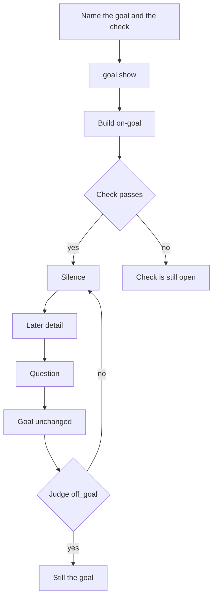

# context-guard

It keeps the current piece of work in front of the model, and only speaks up when the model drops that piece.

Long chats forget the ask. Cursor already summarizes the window. This tool does not score “drift.” It remembers the **mission** and the **current goal**, restates them after each tool, and posts one short redirect if the assistant abandons the open goal.

## Day to day (no Python)

Install the hooks once. Enable Cursor Hooks. Then chat.

| You say | What the tool does |
| --- | --- |
| `/goal …` or `Current goal: …`, plus `Check: …` | Arms the pin for that chat. No chat spam. |
| `/show-goal` | Prints the living goal for this conversation (`goal show`). After recover, that is a re-entry briefing: Arc, Held now, Rejected / cancelled, Open. |
| `Recover goal` | Scans this chat’s saved USER prompts (Composer bootstrap) and arms a briefing-shaped living goal for an older conversation. |
| A later requirement | Adds it to Held. No scold. |
| A question | Does not change the goal. An answer is not a sidetrack. |
| `Actually drop that. …` | Drops that detail, or replaces the goal. Quiet. |
| Check missing or red | One slim correction: the check is still open, then goal + Held only (not Arc / Rejected / Open). Stay on that goal. |
| Same red output twice, or three reds | `Stop and replan. Goal still: …` (slim Held form). |
| Check exits 0 | Silence. Stop runs the named `Check:` for that chat. |
| Judge verdict `off_goal` | One line: `Still the goal: …`, including Held details. |

Each conversation has its own store under `.context-guard/chats/<id>.json`. `/show-goal` without `--conversation` reads `default`; pass the chat id when you mean another thread.

## How the brain decides (no score)

Context-guard keeps a living goal: the sentence you named, the check command, Held requirements, and (after recover) Arc / Rejected / Open. `context-guard goal show` prints the full briefing when those sections exist. The pin and stop loop stay slim: mission, goal, check, Held only. A question does not add a requirement. `Actually drop that` removes a detail or replaces the goal, and does not scold.

The loop does not read the chat for new rules. It reads the check:

- No check recorded, or the last run is red: one correction, the check is still open, stay on that goal.
- The same red output twice, or three reds: `Stop and replan. Goal still: …`
- The check exits 0: silence.

A reply is other work only when the judge returns `off_goal`. Then one line: `Still the goal: …`, including Held details. "Looks done" and model confidence are not checks. Pytest injects a scripted extractor and a scripted judge so the default suite stays offline.

## How it works in real time

The live feature is the exempt-invoice goal. Left = chat. Right = what context-guard does.

| Step | Chat | context-guard |
| --- | --- | --- |
| 1 | Name the goal — exempt invoice, plus the check | Pin. `goal show` prints both. Silence. |
| 2 | Build on-goal — fix `invoice.py`. Check passes | Silence |
| 3 | Later detail — home-state reseller rule, marketplace never exempt | Both land on the goal. Silence. |
| 4 | Question — anything else in the folder misleading about tax? | Goal unchanged. Silence. |
| 5 | Judge verdict `off_goal` | One `Still the goal` line that includes those details |



## What this is not

- Not a “no drift detected” status line.
- Not a keyword or file-path score.
- Not a skill you run every message.
- Not a grade for a vague brainstorm with no check.

## For developers of this package

Primary features: [`features/stay_on_unit.feature`](features/stay_on_unit.feature), [`features/recover_goal.feature`](features/recover_goal.feature).

**How to run the living-goal feature (live model every time):**

```bash
.venv/bin/python examples/run_stay_on_unit_live.py
```

That starts one Composer 2.5 chat (Fast off) on the broken invoice, sends the two late tax rules, then asks a question. It does not order a sidetrack. `goal show` must list both rules. A passing check stays silent. The question must not post `Still the goal`. The log is [`examples/live-run-log.json`](examples/live-run-log.json). Needs `cursor-sdk`, Python ≥ 3.10, and `CURSOR_API_KEY` (env or one line in `~/.zshrc`).

**Recover an older chat (live model):**

```bash
.venv/bin/python examples/run_recover_goal_live.py
```

Seeds prompts with no `Current goal:` / leading `/goal`, runs `Recover goal` through production `CursorModelBootstrap`, asserts `goal show`, then one on-goal agent turn. Log: [`examples/live-recover-log.json`](examples/live-recover-log.json).

**Grade a recovered summary (live model, separate from the writer):**

```bash
.venv/bin/python examples/run_recover_grade_live.py
```

Prints three blocks: product `goal show` from Composer 2.5 (briefing shape), the rubric, then a Grok 4.7 grade (medium reasoning, Fast off, no tools). Exit 0 only when that grade passes. Live logs are gitignored. That command is the named check for this measurement. A red result is the stop loop. It does not open another plan.

Optional aspirational bar (not the day-to-day path): [`examples/run_aaa_goal_summary.py`](examples/run_aaa_goal_summary.py) writes a Grok full-read briefing beside product recover; see [`examples/LAST_AAA_GOAL_SUMMARY.md`](examples/LAST_AAA_GOAL_SUMMARY.md).

**Offline gate** (default; no model):

```bash
python3 -m pytest -q
python3 examples/verify_live_story.py
```

`verify_live_story.py` replays [`examples/fixtures/live_chat.json`](examples/fixtures/live_chat.json) for the older fixture path, then checks this README still names the living-goal story. Optional: `pytest -m live` shells out to the live runner (excluded from default `pytest -q`).

Optional CLI to name a goal without typing it in chat:

```bash
python3 -m context_guard goal start \
  --mission "ship context-guard" \
  --goal "wire prompt ingest" \
  --done-means "the hook stores the user prompt"
```

Chat state: `.context-guard/chats/<id>.json`. Skills: [`.cursor/skills/context-guard`](.cursor/skills/context-guard/), [`.cursor/skills/show-goal`](.cursor/skills/show-goal/). Decisions: [`DECISIONS.md`](DECISIONS.md).
