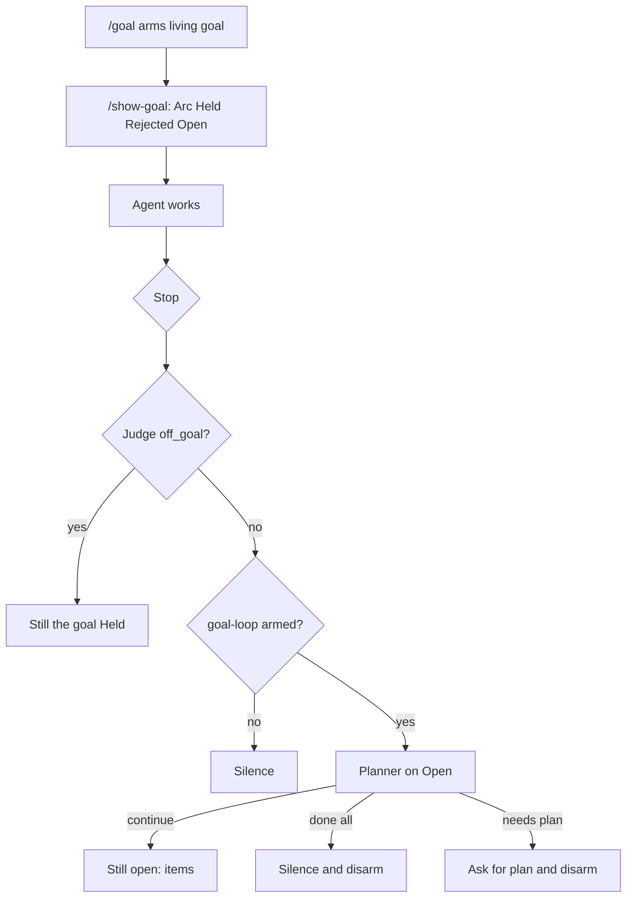

# context-guard

Long chats lose the ask. Unfinished work dies when the model stops short.

**context-guard** keeps a living goal in front of the model: Held expands as you add rules, the guard stays silent when the reply is on track, and one `Still the goal` line lands when it is not. Recover rebuilds Arc / Held / Rejected / Open for an older chat. Optionally, `/goal-loop` keeps pushing Open items from `/show-goal` until the list is empty or a plan is required — with little babysitting.

Three steps: install the hooks once, say `/goal …`, keep working. Use `/show-goal` to see what is held. Say `Recover goal` on an older thread. Arm `/goal-loop` only when you want the Open list driven.

Proof (live Composer, not a stub): [`features/stay_on_unit.feature`](features/stay_on_unit.feature) via `.venv/bin/python examples/run_stay_on_unit_live.py` — late rules stick, a question stays silent, on-track stops stay silent, a user sidetrack gets Still the goal. Offline pytest covers Guard, recover, and optional Open-list `/goal-loop`.

## Once (this repo)

Hooks and skills already live under `.cursor/`. Open the project in Cursor, enable **Cursor Hooks**, then chat.

Optional: `python3 -m pip install -e .` for the `context-guard` CLI (hooks already put `src` on `PYTHONPATH`). Live Guard / recover / planner need `CURSOR_API_KEY` in the environment.

## Day to day (no Python)

Then chat.

| You say | What the tool does |
| --- | --- |
| `/goal …` or `Current goal: …` | Arms the pin for that chat. No chat spam. |
| `/show-goal` | Prints the living goal (`goal show`). After recover: Arc, Held now, Rejected / cancelled, Open. |
| `Recover goal` | Scans this chat’s USER prompts and arms a briefing-shaped living goal for an older conversation. |
| `/goal-loop` | Arms the optional Open-list loop. Silent when arming. |
| `/goal-loop off` | Disarms the loop. |
| A later requirement | Adds it to Held. No scold. |
| `Open: …` | Adds an unfinished item to Open (for `/goal-loop`). |
| A question | Does not change the goal. An answer is not a sidetrack. |
| `Actually drop that. …` | Drops that detail, or replaces the goal. Quiet. |
| Judge verdict `off_goal` | One line: `Still the goal: …`, including Held. |
| `/goal-loop` armed + Open left | One `Still open: …` line; finished items drop; empty Open disarms. |
| `/goal-loop` + needs a plan | One plan-request line; loop disarms. |

Each conversation has its own store under `.context-guard/chats/<id>.json`. `/show-goal` without `--conversation` reads `default`; pass the chat id when you mean another thread.

Optional `Check: …` may still sit on the goal for humans and live runners. It is not what “loop” means and does not drive stop follow-ups.

## How the brain decides (no score)

Context-guard keeps a living goal: the sentence you named, Held requirements, and (after recover or `Open:`) Arc / Rejected / Open. `context-guard goal show` prints the full briefing when those sections exist. The pin stays slim: mission, goal, Held only.

- **Guard** — a reply is other work only when the judge returns `off_goal`. Then one line: `Still the goal: …`. On track: silence.
- **Loop (optional)** — only when `/goal-loop` is armed. A planner reads goal + Open. Continue → `Still open: …`. Done items leave Open. Nothing left, or `needs_plan` → silence or one plan ask, then disarm. Planner unavailable → silence (do not invent).

A question does not add a requirement. `Actually drop that` removes a detail or replaces the goal, and does not scold. Pytest injects a scripted extractor, judge, and planner so the default suite stays offline.

## How it works in real time



The live feature is the exempt-invoice goal. Left = chat. Right = what context-guard does.

| Step | Chat | context-guard |
| --- | --- | --- |
| 1 | Name the goal — exempt invoice — and fix `invoice.py` | Pin. On-track stop: silence. |
| 2 | Later detail — home-state reseller rule, marketplace never exempt | Both land on Held. |
| 3 | User sidetrack — write a billing homepage instead of the invoice | Judge `off_goal`. One `Still the goal` line that includes those details. |
| 4 | Question — anything else in the folder misleading about tax? | Goal unchanged. Silence. |
| 5 | Optional — `Open: …` then `/goal-loop` | Stop posts `Still open:` until Open is empty or a plan is needed. |

## What this is not

- Not a “no drift detected” status line.
- Not a keyword or file-path score.
- Not a skill you run every message.
- Not a shell Check nag on every stop.

## For developers of this package

Primary features: [`features/stay_on_unit.feature`](features/stay_on_unit.feature), [`features/recover_goal.feature`](features/recover_goal.feature), [`features/goal_loop.feature`](features/goal_loop.feature).

**Offline gate** (default; no model), including scripted `off_goal` and `/goal-loop`:

```bash
python3 -m pytest -q
```

**On-track and guard proof** (live Composer every time):

```bash
.venv/bin/python examples/run_stay_on_unit_live.py
```

One Composer 2.5 chat (Fast off) on the broken invoice: late tax rules stick, on-track stops stay silent, a user ask for a billing homepage must get `Still the goal` with both rules, and a question must not. “Actually drop that” stays offline. The log is gitignored at `examples/live-run-log.json`. Needs `cursor-sdk`, Python ≥ 3.10, and `CURSOR_API_KEY` (env or one line in `~/.zshrc`).

Recover and grade runners below measure older chats and summary quality. They are not the on-track proof.

**Recover an older chat (live model):**

```bash
.venv/bin/python examples/run_recover_goal_live.py
```

Seeds prompts with no `Current goal:` / leading `/goal`, runs `Recover goal` through production `CursorModelBootstrap`, asserts `goal show`, then one on-goal agent turn. Log: [`examples/live-recover-log.json`](examples/live-recover-log.json).

**Grade a recovered summary (live model, separate from the writer):**

```bash
.venv/bin/python examples/run_recover_grade_live.py
```

Prints three blocks: product `goal show` from Composer 2.5 (briefing shape), the rubric, then a Grok 4.7 grade (medium reasoning, Fast off, no tools). Exit 0 only when that grade passes. Live logs are gitignored.

Optional aspirational bar (not the day-to-day path): [`examples/run_aaa_goal_summary.py`](examples/run_aaa_goal_summary.py) writes a Grok full-read briefing beside product recover; see [`examples/LAST_AAA_GOAL_SUMMARY.md`](examples/LAST_AAA_GOAL_SUMMARY.md).

**Older fixture replay** (no model):

```bash
python3 examples/verify_live_story.py
```

`verify_live_story.py` replays [`examples/fixtures/live_chat.json`](examples/fixtures/live_chat.json) for the older fixture path, then checks this README still names the living-goal story. Optional: `pytest -m live` shells out to the live runner (excluded from default `pytest -q`).

Optional CLI to name a goal without typing it in chat:

```bash
python3 -m context_guard goal start \
  --mission "ship context-guard" \
  --goal "wire prompt ingest" \
  --done-means "the hook stores the user prompt"
```

Chat state: `.context-guard/chats/<id>.json`. Skills: [`.cursor/skills/context-guard`](.cursor/skills/context-guard/), [`.cursor/skills/show-goal`](.cursor/skills/show-goal/), [`.cursor/skills/goal-loop`](.cursor/skills/goal-loop/). Decisions: [`DECISIONS.md`](DECISIONS.md).
