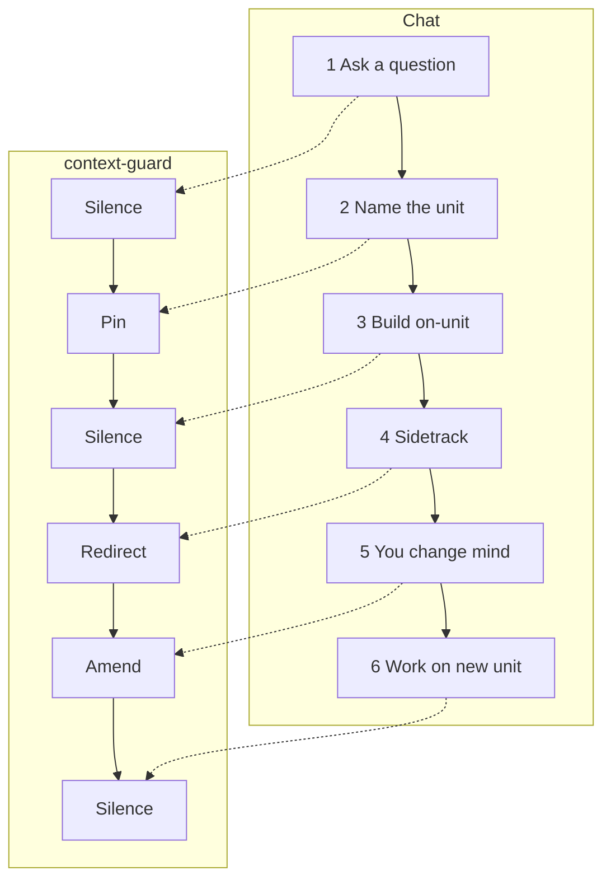

# context-guard

It keeps the current piece of work in front of the model, and only speaks up when the model drops that piece.

Long chats forget the ask. Cursor already summarizes the window. This tool does not score “drift.” It remembers the **mission** and the **current unit**, restates them after each tool, and posts one short redirect if the assistant abandons the open unit.

## Day to day (no Python)

Install the hooks once. Enable Cursor Hooks. Then chat.

| You say | What the tool does |
| --- | --- |
| A question | Records it. No mission. Silence. |
| `Current unit: …` or `Mission: …` | Arms the pin. Still no chat spam. |
| Agent works on that unit | Invisible pin. Quiet stop. |
| Agent leaves the unit | One line: `Still the unit: …. Continue only that.` |
| `Actually drop that. …` | Unit amends. Quiet again. |

## How it works in real time

Same chat as the live fixture. Left = what happens in the chat. Right = what context-guard does.

| Step | Chat | context-guard |
| --- | --- | --- |
| 1 | You ask why `add()` is missing | Silence |
| 2 | You set `Current unit: add(a, b)…` | Pins that unit (invisible) |
| 3 | Agent builds `add.py`, check passes | Still silence |
| 4 | Agent ships a homepage instead | One line: stay on `add(a, b)` |
| 5 | You say drop that — do the homepage | Unit updates |
| 6 | Agent works on the homepage | Silence again |



## What this is not

- Not a “no drift detected” status line.
- Not a keyword or file-path score.
- Not a skill you run every message.
- Not a grade for a vague brainstorm with no unit.

## For developers of this package

Primary feature: [`features/stay_on_unit.feature`](features/stay_on_unit.feature).

**How to run this feature (live model every time):**

```bash
python3 examples/run_stay_on_unit_live.py
```

That starts one Composer 2.5 chat, builds `add(a, b)`, sidetracks to a homepage, applies context-guard to those fresh replies, and writes [`examples/live-run-log.json`](examples/live-run-log.json). Needs `cursor-sdk`, Python ≥ 3.10, and `CURSOR_API_KEY` (env or one line in `~/.zshrc`). It does not fall back to the fixture.

**Offline gate** (default; no model):

```bash
python3 -m pytest -q
python3 examples/verify_live_story.py
```

`verify_live_story.py` replays [`examples/fixtures/live_chat.json`](examples/fixtures/live_chat.json): unit check (`add(2,3)==5`) + product behavior + story/diagram match against this README. Optional: `pytest -m live` shells out to the live runner (excluded from default `pytest -q`).

Optional CLI to name a unit without typing it in chat:

```bash
python3 -m context_guard unit start \
  --mission "ship context-guard" \
  --goal "wire prompt ingest" \
  --done-means "the hook stores the user prompt"
```

Chat state: `.context-guard/chats/<id>.json`. Decisions: [`DECISIONS.md`](DECISIONS.md).
